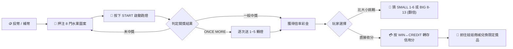

# 🎰 經典復古小瑪莉街機（麻仔台／水果盤）

一個基於現代 Web 技術純手工打造的經典懷舊「小瑪莉」（麻仔台 / 水果盤）街機模擬器。全站採用零相依單檔案架構，完美還原 80、90 年代台灣與亞洲街機廳的實體機台視覺、動態跑燈、晶片合成音效與出分體驗。

---

## 🌟 核心特色

### 1. 經典 24 格街機盤面與 LED 點位還原
- **8 門熱門水果圖案**：BAR (x25~x100)、雙星 (x30)、77 (x40)、西瓜 (x20)、鈴鐺 (x20)、芒果 (x15)、橘子 (x10)、蘋果 (x5) 以及各類小水果 (x2)。
- **內緣紅色圓形 LED 指示燈**：真實模擬實體機台每個格子內緣的紅色發光二極體，具備發光暈眩與熄滅層次。

### 2. ONCE MORE 經典「逐次送燈」機制
- 當指針停在綠色字 **ONCE MORE（再次機會）** 時，即刻觸發送燈特效。
- **隨機 1 ~ 5 顆燈**：每顆燈擁有獨立加減速曲線，**逐次循序跑動、逐一定格鎖定**，前一顆送出的燈持續恆亮，重現街機廳最刺激的連鎖爆分體感。
- 送燈完成後自動結算各格彩金，支援多重命中累計總分。

### 3. 雙列式街機實體按鍵盤
- **第一列（操作與比倍鍵）**：
  - `PAY`：退幣兌換代幣。
  - `WIN ↔ CREDIT`：贏分與信用分轉存切換。
  - `比大小（猜大小模式）`：提供 `SMALL 1-6`、`BIG 8-13` 雙倍比倍挑戰，7 點通殺送安慰獎。
  - `START`：啟動旋轉（支援一鍵續押上一輪注額）。
- **第二列（8 門押注鍵）**：
  - BAR、雙星、77、西瓜、鈴鐺、芒果、橘子、蘋果獨立押注按鍵，每鍵支援即時累積注額與倍率指示。

### 4. 街機水箱池與動態 RTP 演算
- 具備模擬實體街機內部「水箱（Water Pool）」進出帳累積機制。
- 支援動態出分回報率（RTP）即時監控與水箱動態平衡。

### 5. 懷舊娃娃商品兌換商城
- 贏取的分數可退為口袋代幣，並可於「娃娃商城」兌換 8 款經典懷舊公仔與商品。
- 支援瀏覽器本地儲存（`localStorage`），收集到的獎品永久儲存於玩家背包。

### 6. 純 Web Audio API 晶片音效引擎
- 無需外部音訊 mp3/wav 檔案，完全利用瀏覽器底層 `AudioContext` 振盪器（Oscillator）即時合成街機經典方波（Square）、正弦波（Sine）與鋸齒波（Sawtooth）電子音效。

---

## 🕹️ 遊戲操作指引

1. **投幣開局**：
   - 點擊機台投幣口即可投入代幣，每次增加 10 分（若口袋代幣用罄，系統將自動從皮夾補充）。
2. **下注配置**：
   - 點擊下方 8 門水果按鍵進行押注（每門最高 99 分）。
3. **啟動跑馬燈**：
   - 按下綠色 **`START`** 鍵，若本局尚未押注會自動沿用上一局注額啟動。
4. **贏分比倍（Double Up）**：
   - 中獎後進入比倍待命狀態，可選擇點擊 `SMALL (1-6)` 或 `BIG (8-13)` 進行點數翻倍；亦可隨時按 `WIN ↔ CREDIT` 將得分入帳。
5. **娃娃兌換**：
   - 點擊「🧸 娃娃商城」將辛苦贏來的代幣兌換為復古毛絨玩偶、GameBoy、紅白機等經典收藏品！

---

## 🛠️ 技術架構

| 模組 | 技術實現 | 說明 |
| :--- | :--- | :--- |
| **前端結構** | HTML5 Semantic Elements | 單檔免編譯，開箱即用 |
| **樣式排版** | Tailwind CSS CDN + 自定義 CSS | 擬真深色街機外框、金屬質感按鍵、LED 霓虹發光 |
| **音效合成** | Web Audio API (`AudioContext`) | 晶片級動態頻率合成，零網路延遲與資產遺失風險 |
| **遊戲迴圈** | Non-blocking `setTimeout` + 曲線演算法 | 平滑模擬加速、高速巡航與煞停減速曲線 |
| **資料持久化** | HTML5 `localStorage` | 自動保存錢包代幣餘額與已收藏娃娃商品清單 |

---

## 💻 本地運行說明

本專案為零依賴靜態網頁，無需安裝 Node.js、Python 或任何後端伺服器環境：

1. 下載或複製本專案目錄。
2. 使用任何現代瀏覽器（Google Chrome、Edge、Safari、Firefox）直接雙擊開啟：
   - `index.html` 或 `小瑪莉（麻仔台／水果盤）.html`
3. 立即重溫 80 年代小瑪莉經典街機！

---

## 📄 版權與免責聲明

本專案僅供純前端技術研究、經典復古遊戲介面還原與懷舊娛樂使用。遊戲內所有點數、分數與代幣均為虛擬數值，無任何真實金錢交易功能。
